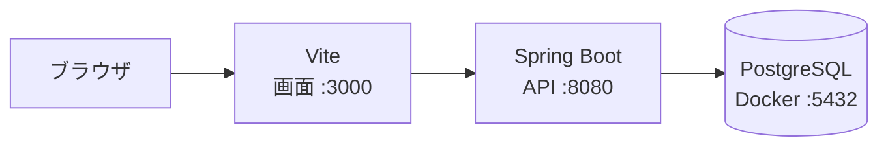
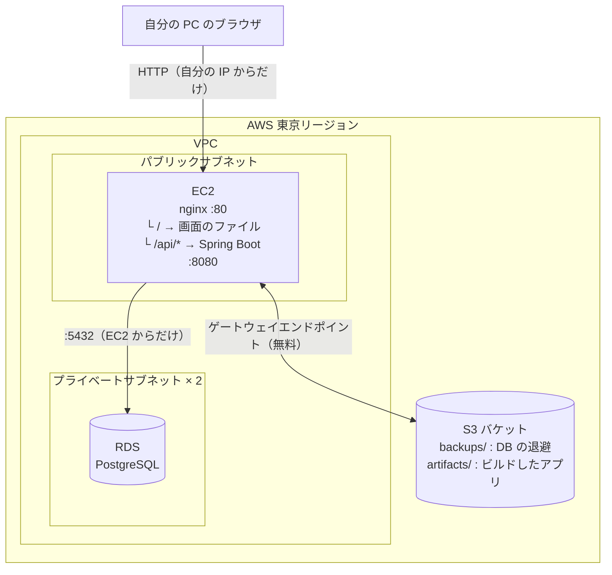

# インフラ構成書

**版 1.0**（2026-10-14）

このアプリを AWS 上で動かすための構成と、そう決めた理由をまとめる。

- **設定値の正本は Terraform のコード**（[infra/](../infra/)）。この文書は「なぜその値なのか」を残すためのもので、値そのものは変わりうる。食い違っていたらコードが正しい
- 権限と秘密情報の扱いは [セキュリティ設計](security.md)
- 日々の操作の手順は [運用手順](operations.md) の「5. AWS での作業」
- ファイル単位の説明は [infra/README.md](../infra/README.md) と [scripts/aws/README.md](../scripts/aws/README.md)

---

## 改訂履歴

| 版 | 日付 | 内容 |
| --- | --- | --- |
| 1.0 | 2026-10-14 | 初版。Git 管理外だったデプロイガイド（`docs/deployment/`）のうち、構成と費用に関する内容を移した |

---

## 1. 前提

| 項目 | 決めたこと | 理由 |
| --- | --- | --- |
| 構成 | **EC2 1台に画面と API を載せ、DB は RDS に置く** | 部品が少なく、費用も安い。DB を RDS にしたのは学習カリキュラムに合わせたため |
| リージョン | 東京（`ap-northeast-1`） | 日本から使うため |
| 認証 | **実装しない。** 代わりに**自分の IP アドレスからだけ**アクセスを許可する | アプリに認証機能が無いため。自分専用の使い方に限る |
| 動かし方 | **作業の始めに作り、終わりに消す** | 存在している時間にだけ料金がかかるため |
| データ | 消す前に **S3 に退避**し、次に作ったときに戻す | destroy すると RDS ごと消えるため |
| アプリの載せ方 | **PC でビルド**し、S3 経由で EC2 に運んで、**Docker を使わずに**動かす | EC2 のメモリが 1GB のため |
| 無料枠 | **新規向けのクレジットは使えない前提**で考える | 過去アカウントの事情により付与されないため。誰でも使える Always Free の枠はある |

> **要件との関係。** [要件定義書](requirements.md) の前提条件 P-2 は「外部公開せず、利用者の PC 内でのみ動作する」としていた。インターネット上のサーバーに置くことは、この前提を一部緩める判断になる。**アクセスできる相手を自分の IP に限る**ことで補っている。経緯は要件定義書の該当節に記録した。

---

## 2. 全体の構成

### 2.1 ローカル（開発時）



### 2.2 AWS 上



**画面と API は同じサーバーに載せる。** 画面を S3 と CloudFront で配る形もあるが、まずは一番シンプルな形にした。サーバーへの操作は Session Manager で行い、**SSH の入口は開けていない。**

### 2.3 作るもの

Terraform で、作業のたびに作って消すもの（[infra/](../infra/)）:

| もの | 役割 |
| --- | --- |
| VPC・サブネット・インターネットゲートウェイ・経路表 | サーバーを置くネットワーク |
| セキュリティグループ | 入口の門番。自分の IP からだけ通す |
| EC2・EBS | サーバー本体とディスク |
| EC2 用の IAM ロール | Session Manager で入る、DB のパスワードを読む、S3 を読み書きする |
| CloudWatch アラーム | 1時間何もしていなければ EC2 を終了する |
| RDS | データベース |
| S3 ゲートウェイエンドポイント | EC2 から S3 への近道 |

消さないもの（[infra/persistent/](../infra/persistent/)。**別の Terraform・別の state** なので destroy で消えない）:

| もの | 役割 |
| --- | --- |
| S3 バケット | バックアップとアプリの置き場。公開禁止・暗号化・バージョニング・2世代のライフサイクルルール |

---

## 3. 主要な設定値

**正本は [infra/](../infra/) の `.tf` ファイル。** ここに書くのは「なぜその値か」の記録で、値は変わりうる。

| 項目 | 値 | 根拠 | 定義場所 |
| --- | --- | --- | --- |
| EC2 のインスタンスタイプ | `t3.micro`（x64・メモリ 1GB） | DB を RDS に分けたので画面と API だけなら足りる。ARM（`t4g`）より月 $0.17 ほど高いが、**PC でビルドしたものをそのまま動かせる** | `ec2.tf` / `variables.tf` |
| EC2 の CPU クレジット | `standard` | 下の「3.1 CPU の借り越し」 | `ec2.tf` |
| EC2 のディスク | gp3・8GB | Amazon Linux 2023 の標準が 8GB。実際の使用は OS 1.8GB ＋ Java 0.2GB ＋ アプリ 0.05GB ＋ スワップ 1GB で収まる | `ec2.tf` |
| RDS のインスタンスタイプ | `db.t3.micro`（x64・メモリ 1GB） | PostgreSQL 17 が使える最小構成。ARM との差は月 $0.2 程度 | `rds.tf` / `variables.tf` |
| PostgreSQL のバージョン | `17`（AWS が選ぶ 17 系の標準。実績 17.9） | ローカルの Docker と揃える | `rds.tf` |
| RDS のディスク | gp3・20GB | RDS の最小容量 | `rds.tf` |
| 許可する接続元 | 自分の IP の `/32` | 下の「4.2」 | `terraform.tfvars`（Git 管理外） |
| 自動停止のアラーム | CPU がほぼ無使用の状態が 1 時間続いたら**終了（terminate）** | 下の「6.4」「6.5」 | `alarm.tf` |
| state の置き場 | PC のローカル（`.gitignore` 済み） | 1人開発で共有の必要が無い。S3 に置くかは将来の検討事項 | — |

> **DB のパスワードは state ファイルに平文で書かれる。** state を人に渡したり貼り付けたりしない。EC2 側はパラメータストアから起動の直前に読むので、ファイルには残らない。

### 3.1 CPU の借り越し（`standard` にした理由）

`t3`・`t4g` は、**ふだんは CPU の一部だけを使う前提の安いタイプ**。使い続けてよい割合を**ベースライン**と呼び、`micro` は CPU 1つあたり 10%。ベースラインより少なく使っている間は「CPU を使う権利（CPU クレジット）」がたまり、多く使うときはそれを消費する。

権利が尽きたときの動きは 2 通り選べる。

| 設定 | 権利が尽きたら | 料金 |
| --- | --- | --- |
| `unlimited`（既定） | 借り越して使い続ける | 借り越した分を停止・削除時に精算（CPU 1つを1時間使い切るごとに $0.05） |
| **`standard`（採用）** | ベースラインまで速度が落ちる | 増えない |

**作って消す運用では、作った直後の権利が 0 になる。** 追加料金を出さない方を選んだ。実測では、作った直後でも API の起動は約 12 秒で済んでいる。

> **T3 に「起動直後の貯金」（ローンチクレジット）は無い**（公式では T2 のみ）。実測が速かったのは、RDS ができるのを待つ約 5 分の間に EC2 が権利を貯めていたためと考えられる（CloudWatch の記録では借り越し 0・上乗せ料金 0）。

出典：AWS 公式「Key concepts for burstable performance instances」「Unlimited mode concepts for burstable instances」

---

## 4. ネットワーク

| 決めたこと | 理由 |
| --- | --- |
| **VPC は自分で作る**（デフォルト VPC を使わない） | 仕組みを学べる。destroy で全部消えてまっさらに戻る。RDS をプライベートサブネットに置ける。どちらも無料 |
| EC2 は**パブリックサブネット**に置く | インターネットから直接届くようにするため |
| RDS は**プライベートサブネット 2つ**に置く | インターネットから直接届かないようにするため。RDS はサブネットグループに 2 つ以上の AZ を要求する |
| **NAT ゲートウェイは使わない** | 置くだけで月約 $45 かかる。**未経験者がよく踏む費用の落とし穴** |
| S3 へは**ゲートウェイエンドポイント**を通す | 無料で、インターネットを経由しない近道 |
| パブリック IPv4 は**起動時の自動割り当て** | Elastic IP（固定 IP）は持っているだけで料金がかかるため |

### 4.1 セキュリティグループ

| 対象 | 許可する通信 |
| --- | --- |
| EC2 | **自分の IP から** HTTP（:80）のみ |
| RDS | **EC2 から** PostgreSQL（:5432）のみ |

### 4.2 自分の IP だけを許可する

ログイン機能を作らない代わりに、セキュリティグループで接続元を自分の IP に限っている。

IP の調べ方（`checkip.amazonaws.com` は、アクセス元の IP を返すだけの AWS のページ）:

```powershell
(Invoke-WebRequest -Uri https://checkip.amazonaws.com -UseBasicParsing).Content.Trim()
```

**家のインターネットの IP は変わることがある**（ルーターの再起動などで）。変わるとサーバーに入れなくなるので、調べ直して `infra/terraform.tfvars` を書き換え、`apply` し直す。

**IP の値は `*.tfvars` に書き、`.tf` には書かない。** `*.tfvars` は `.gitignore` に入っているのでコミットされない。

---

## 5. データの持ち方

destroy すると **RDS も消え、データベースの中身も消える。** そこで、destroy の前にデータを外へ退避し、次に作ったときに戻す。

### 5.1 方式の比較

| 方法 | 中身 | 料金 |
| --- | --- | --- |
| **S3 に退避（採用）** | `pg_dump` で DB の中身を 1 ファイルに書き出して S3 に置き、次の RDS に書き戻す | 月 $0.01 未満 |
| RDS のスナップショット | RDS を消すときに写しを残し、次はそこから作る | $0.095 / GB・月。destroy 後は無料枠が無い |
| RDS を停止する（消さない） | データはディスクに残る | ディスク代がかかり続ける（20GB で月約 $2.76）。**停止は最長 7 日で、過ぎると AWS が自動で起動し直す** |

**S3 を選んだ理由**：スナップショットと料金はほぼ同じ（どちらも月 $0.01 未満）で、**退避したファイルを PC の Docker の PostgreSQL にもそのまま書き戻せる**ため。どの方法でも、戻るのは最後に退避した時点の状態。

### 5.2 安全のための約束

`scripts/aws/start.ps1` / `stop.ps1` が、次の順序と検査を守る。

- **退避が成功しないと destroy に進まない**
- 退避した直後に、そのファイルが読み込めるかを検査する
- 復元の前に **DB が空であること**を確かめ、空でなければ止める
- **復元はアプリの起動より前に行う。** 先に起動すると Flyway が初期データを入れてしまい、戻したデータとぶつかる
- 復元は 1 つのトランザクションで行い、失敗したら何も書き戻さなかったことになる。書き戻した後、表ごとの件数を退避時と照合する
- **前回 1 件以上あった表が 0 件になっていたら、退避を止めて確認を求める**（復元に失敗した空の DB を退避して、良いバックアップを押し出さないため）
- 古い世代は S3 のライフサイクルルールで自動的に消す

### 5.3 2世代の残し方

いつも同じ名前で上書きし、バージョニングで「1つ前」を残し、それより古い版は S3 が自動で消す。**人も AI も削除の操作をしなくて済む。** 消える対象は「古くなってから 1 日以上たった版」なので、1 日に何度も退避した日は一時的に 3 世代以上残る。

### 5.4 確かめたこと

PC の Docker（EC2 と同じ Amazon Linux 2023・PostgreSQL 17）で 21 項目。AWS 上では、退避 → destroy → apply → 復元でデータ（日本語・改行・絵文字・外部キー）が元どおりになること、DB にデータがあるときは復元しないこと、0 件になったら退避も destroy も止まることを確認した。

> **つまずいた点。** Windows の AWS CLI は、ファイルや画面の日本語を Windows の文字コード（Shift_JIS 系）で扱う。EC2 に送る命令と EC2 から返る表示に日本語が入っていると、読めずに止まった。どちらも英数字だけの書き方に置き換えて受け渡すことで解決した。**どの場合もスクリプトは安全側に止まり、データが失われることはなかった。**

---

## 6. 費用と安全装置

> **金額は 2026-10 時点の東京リージョンの単価に基づく概算。** 正確な値は AWS の料金ページを見ること。**安全装置の具体的な金額としきい値、実行時刻はこの文書には書かない。**

### 6.1 費用の考え方

**料金は、作ったり消したりする回数ではなく、動かしている（存在している）時間の合計で決まる。** 1 回の作業で「作る → 使う → 消す」をしても、操作そのものに料金はかからない。

| 運用 | 月額の目安 |
| --- | --- |
| 24時間つけっぱなし | 約 $35 |
| **作業のたびに作って消す（1日2時間 × 30日）** | **約 $3.2**（採用） |

動かしている間の合計は**約 $0.05/時**（EC2 側 約 $0.02 ＋ RDS 側 約 $0.03）。内訳は EC2 本体・EBS・パブリック IPv4・RDS 本体・RDS のディスク。

**destroy した後は、月をまたいでも上の料金はかからない。** EC2・ディスク・IPv4・RDS はどれも「存在している時間」に課金されるものなので、destroy で無くなる。残るのは S3 のバックアップ（月 $0.01 未満）と安全装置（ほぼ 0）だけ。

> 料金のかかり方には 2 種類ある。**呼ばれたときだけかかるもの**（Lambda、スケジュール、SNS）は止めれば料金も止まる。**存在している時間にかかるもの**（EC2、ディスク、IPv4、RDS）は、止めるのではなく**消す**必要がある。

### 6.2 見落としやすい費用

| もの | 料金 | 対策 |
| --- | --- | --- |
| NAT ゲートウェイ | 置くだけで月約 $45 | 使わない設計（4章） |
| **Cost Explorer の API** | **1回 $0.01**（画面で見るのは無料） | コストの確認は請求画面で行う。AI に API を使わせるときは事前に人へ伝える |
| **destroy のし忘れ** | 1日つけっぱなしで約 $1.2 | 下の安全装置 |
| CPU の借り越し | 作った直後に CPU を多く使うと 1 回あたり数セント | `standard` にして回避（3.1） |

> **実際にあったこと。** AI が権限の確認のために Cost Explorer の API を断りなく 1 回呼んだ（$0.01）。以後、事前に伝える約束にした。

### 6.3 無料枠について

AWS の無料枠には**別々の 2 種類**がある。

| 種類 | 中身 | このアカウント |
| --- | --- | --- |
| 新規向けのクレジット | 新しいアカウントに $100。使い切るか 6 か月で終わる | **付いていない** |
| **Always Free（ずっと無料）** | サービスごとの「毎月ここまでは無料」の枠。期限なし | **付いている** |

請求とコスト管理の「無料利用枠」の画面で、`always free` と書かれた行（Lambda、CloudWatch など）があることで確認した。この画面の表には**使ったことのあるサービスの枠だけ**が出る。

### 6.4 安全装置の全体像

| 何が起きたら | 何が働くか | 作り方 |
| --- | --- | --- |
| 今月の実績が予算の一定割合を超えた | 予算 → メール | AWS CLI |
| 今月の実績が予算を超えた | 予算 → メール ＋ SNS `guard-killswitch` → Lambda が EC2 を停止 → メール | AWS CLI |
| 月末の予測が予算を超えそう | 予算 → メール | AWS CLI |
| 毎晩、決まった時刻になった | EventBridge Scheduler `guard-nightly-stop` → 同じ Lambda で停止 | AWS CLI |
| **1時間ほぼ何もしていない** | CloudWatch アラーム → **EC2 を終了** → メール | **Terraform**（EC2 と一緒に作る） |
| いつもと違うお金の使われ方 | Cost Anomaly Detection → 1日1回メール | 既定の設定を調整 |

**どれも AWS の中で動くので、自分の PC の電源を切っていても働く。**

役割の分担:

- **すぐに止める**のは、1時間何もしないときの停止と、夜間の停止
- **予算による停止は最後の安全網。** 予算が見ている金額の更新は 1 日に数回なので、超えてから止まるまで数時間遅れることがある

> ⚠️ **RDS は、EC2 用の安全装置では止まらない。** 自動停止の Lambda も CloudWatch アラームも **EC2 しか止めない。** RDS を止める処理は別途足してある。**「止まったから大丈夫」ではなく、必ず destroy まで行う。**

### 6.5 自動停止の仕組み

Lambda `guard-killswitch` は、呼ばれると次を行う。

1. **東京リージョンを最初に**、その後すべてのリージョンで、動いている EC2 を探す
2. 見つけたものをすべて停止する
3. 結果を SNS `guard-alerts` でメールする（夜間の定時実行で何も止めなかった日はメールを送らない）

| 決めたこと | 理由 |
| --- | --- |
| 対象を名前で決め打ちしない | サーバーは作業のたびに作り直されるため |
| すべてのリージョンを見る | 鍵が漏れた場合、遠いリージョンでサーバーを立てられることが多いため |
| **停止であって削除ではない** | 削除するとバックアップを取る前のデータが消える。停止なら後で起動して退避できる |
| 通知用の SNS を 2 つに分ける | `guard-killswitch` は Lambda を呼ぶ専用。結果を同じものに流すと **Lambda が自分自身をまた呼んでしまう** |

なお、**Terraform で作る CloudWatch アラームの方は「停止」ではなく「終了（terminate）」**にしている。DB は RDS にあるので、EC2 を終了してもデータは消えない。終了なら EC2 とディスクの料金がどちらも止まる。

### 6.6 予算の通知の性質

| 性質 | 内容 |
| --- | --- |
| 予測の通知 | **約 5 週間分の利用データがたまるまで鳴らない** |
| 実績の通知 | **1つの予算につき 1 か月に 1 回だけ。** 予算超えで止めた後、同じ月に再度動かしても 2 回目の停止は起きない（そこは夜間停止と 1 時間無使用の停止が担う） |
| 対象 | **アカウント全体**の料金。このアプリだけではない |

予算の通知だけなら**何個作っても無料**。使いすぎたときに止める仕組みは、AWS 標準の Budget Actions（数によって課金）ではなく **SNS → Lambda** で自作している。

### 6.7 コンソールでの確認場所

**東京リージョンのものは、画面右上のリージョンが「アジアパシフィック（東京）」になっていないと表示されない。**

| もの | 場所 |
| --- | --- |
| 夜間停止のスケジュール | EventBridge →「スケジューラ」→「スケジュール」 |
| EC2 を止める処理 | Lambda →「関数」。**「モニタリング」タブの「呼び出し」のグラフ**で毎晩動いているか分かる |
| 処理のログ | CloudWatch →「ロググループ」 |
| 通知 | SNS →「トピック」 |
| 予算 | 請求とコスト管理 →「予算」 |
| いつもと違う使われ方の検知 | 請求とコスト管理 →「コスト異常検出」 |
| 無料利用枠・請求書 | 請求とコスト管理 →「無料利用枠」「請求書」 |

---

## 7. 構成の比較（なぜ EC2 1台か）

24時間動かした場合の月額の目安（概算。この比較は RDS に切り替える前に行った）:

| 構成 | 中身 | 月額の目安 | 採否 |
| --- | --- | --- | --- |
| **A** | EC2 1台にアプリを載せる | 約 $22 | **採用**（DB は後から RDS に分けた） |
| B | ECS Fargate ＋ ALB ＋ RDS | 約 $60〜80 | 不採用 |
| C | S3 ＋ CloudFront（画面）＋ App Runner（API）＋ RDS | 約 $30〜50 | 不採用 |

A を選んだ理由:

- **部品が少ない。** 学習の最初の一歩として、何が起きているか追いやすい
- **安い。** B は ALB だけで月約 $18 かかる

B・C には「利用者が増えても耐えられる」「サーバーが落ちても自動で直る」という強みがあるが、**自分 1 人で使うアプリには過剰**と判断した。

### 7.1 DB を RDS に分けた理由

当初は「PostgreSQL を EC2 の中で Docker で動かす」設計だった。

| | EC2 に同居（当初案） | **RDS に分ける（採用）** |
| --- | --- | --- |
| EC2 に載るもの | 画面・API・DB | 画面・API |
| EC2 に要るメモリ | 2GB（`small`） | 1GB（`micro`） |
| DB の面倒を見るのは | 自分 | AWS |
| 月額（作って消す運用） | 約 $2.1 | 約 $3.2 |

**切り替えた理由は、学習カリキュラムに沿って EC2 → RDS → デプロイの順に 1 つずつ学ぶため。** 費用は月に約 $1 増えるが許容範囲で、カリキュラムを終えた後は destroy すればどちらの案でも料金はほとんどかからない。

### 7.2 アプリの載せ方

| 項目 | 決めたこと | 理由 |
| --- | --- | --- |
| ビルドする場所 | **PC** | EC2 はメモリ 1GB で、作った直後は CPU も遅い。**Java のビルドツールはメモリを多く使うため、EC2 上でビルドすると足りなくなる心配がある** |
| EC2 での動かし方 | **Docker を使わず直接。** API は Java 25（Amazon Corretto）で jar を実行、画面は nginx で配る | 足すものが少なく、運ぶ量も約 51MB で済む（Docker イメージなら約 500MB）。メモリにも余裕ができる |
| 画面から API への中継 | nginx が `/api/` を `127.0.0.1:8080` に中継する | PC で Vite がしているのと同じ形。**アプリのコードを変えずに済む** |
| 運び方 | PC でビルドしたものを S3 の `artifacts/` に置き、EC2 が取ってくる | バックアップと同じバケット。2世代だけ残す（月 $0.003 程度） |
| API の起動 | systemd で専用ユーザーとして動かす。DB のパスワードは起動の直前にパラメータストアから読む | パスワードをファイルに残さない。落ちたら自動で起動し直す |

仕組みのコードは [infra/ec2-setup/](../infra/ec2-setup/) と [scripts/aws/deploy.ps1](../scripts/aws/deploy.ps1)。

---

## 8. 実測値

AWS 上で確認した値（2026-10-12）。**参考値であり、条件が変われば変わる。**

| 項目 | 実測 |
| --- | --- |
| RDS の作成 | 約 5 分 28 秒 |
| RDS の削除 | 約 2 分 |
| API（Spring Boot）の起動 | 約 12 秒 |
| EC2 のメモリ | 使用 412MiB / 空き 358MiB / スワップ 1MiB（全体 911MiB） |
| API の jar | 約 51MB |
| 画面のファイル | 約 0.3MB |

確認した動作：画面の表示／タスクとリストの追加・移動・削除／**モバイル回線（自分以外の IP）から開けない**／`deploy.ps1` で入れ替えてもデータが残る／`stop.ps1` → `start.ps1` でデータが戻る／destroy 後の消え残りなし。

### 8.1 AWS で初めて見つかった不具合

`http://<IP>` で開くと、タスクとリストの追加が効かなかった。画面のコードが ID を `crypto.randomUUID()` で作っていて、**この関数は安全な接続（HTTPS か localhost）でしか使えない**ため。PC の開発は `http://localhost` なので気づけなかった（Issue #134・PR #135 で `crypto.getRandomValues()` を使う形に修正）。

> ⚠️ **HTTPS を使わない今の構成では、ブラウザの「安全な接続でしか使えない機能」（クリップボード API、Service Worker など）を使うと同じことが起きる。**

---

## 9. 今後の検討事項

| 項目 | 状態 |
| --- | --- |
| 予備として RDS のスナップショットも残すか | 保留（2026-10-12）。必要になったら改めて考える |
| 画面を S3 ＋ CloudFront で配る形にするか | 未着手 |
| Terraform の state を S3 に置くか | 未着手。1人開発では必要性が薄い |
| `start.ps1` 全体の所要時間の実測 | 未測定（見込み 15 分前後） |
| HTTPS 化 | 未着手。ドメインと証明書が必要になる |

---

## 10. 検討したが採らなかったもの

| 案 | 効果 | 採らなかった理由 |
| --- | --- | --- |
| スポットインスタンス | EC2 料金が 6〜7 割引 | 一度きりのスポットは「停止」ができず安全装置と噛み合わない。動くようになってから数行で切り替えられる |
| 安全装置を「バックアップ＋削除」に変える | 発動後の費用がほぼ $0 | Run Command と成功確認が加わり複雑になる。可能であることは確認済み |
| EC2 を `micro` より小さく | — | Java・Web サーバーを載せるには、これ以上小さくできない |
| IPv4 をなくす（IPv6 のみ） | $0.005/時が $0 | 自宅回線の IPv6 対応が必要。VPC エンドポイントが 1 つ $0.01/時かかり、かえって高い |
| 長期契約の割引 | EC2 料金の割引 | 使っていない時間も払うことになり、使う時だけ動かす運用と逆 |
